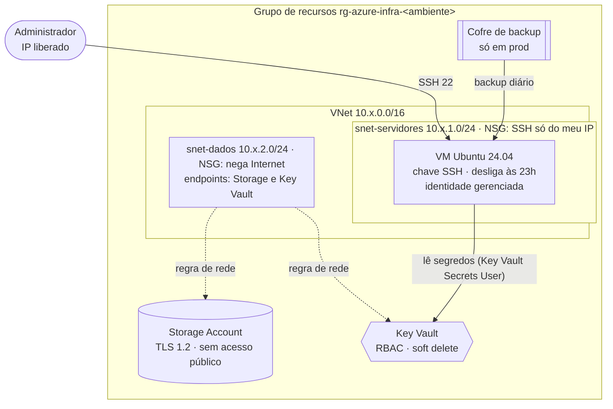

# Infraestrutura no Azure com Bicep

Infraestrutura como código (IaC) modular: um comando cria rede segmentada, VM Linux protegida, Storage Account, Key Vault e backup, com parâmetros separados para **dev** e **prod**. Antes de criar, o script mostra o que vai mudar (what-if). Outro comando apaga tudo. Nada é criado clicando no portal.

## Arquitetura



## Módulos

| Arquivo | O que cria |
| --- | --- |
| `infra/main.bicep` | Orquestra os módulos e aplica as tags |
| `infra/modules/network.bicep` | VNet, 2 sub-redes, 2 NSGs, endpoints de serviço |
| `infra/modules/vm.bicep` | VM Ubuntu, IP público, NIC, desligamento automático |
| `infra/modules/storage.bicep` | Storage Account fechada por rede, container privado, lixeira de 7 dias |
| `infra/modules/keyvault.bicep` | Key Vault com RBAC; permissão de leitura para a identidade da VM |
| `infra/modules/backup.bicep` | Cofre Recovery Services, política diária, proteção da VM |

## Ambientes

| Parâmetro | dev | prod |
| --- | --- | --- |
| Rede | 10.10.0.0/16 | 10.20.0.0/16 |
| VM | Standard_B1s | Standard_B2s |
| Storage | LRS | ZRS (redundância entre zonas) |
| Backup | desligado | diário, 30 dias |
| Proteção contra exclusão do Key Vault | não | sim |

## Decisões de segurança e custo

| Decisão | Motivo |
| --- | --- |
| SSH só por chave, senha desativada | Evita ataques de força bruta |
| NSG libera a porta 22 só para um IP | A VM não fica exposta para a internet |
| Storage e Key Vault com `defaultAction: Deny` | Só a sub-rede de dados e o IP do administrador acessam |
| Storage sem chave compartilhada nem blob público | Acesso só por Entra ID; evita vazamento por link |
| Key Vault com RBAC e identidade gerenciada | A VM lê segredos sem senha guardada no código |
| Desligamento automático diário | VM esquecida ligada é a principal causa de custo em laboratório |
| Tags em todos os recursos | Facilita rastrear custo por projeto e ambiente |
| What-if antes do deploy | Mostra o que vai ser criado, alterado ou apagado antes de aplicar |
| Script de remoção | Apaga tudo, inclusive o backup, que costuma travar a exclusão |

## Custo estimado

Valores **aproximados**, em dólar, região Brazil South, para o ambiente ligado o mês inteiro. Confirme na [Calculadora de Preços do Azure](https://azure.microsoft.com/pricing/calculator/), porque os preços mudam.

| Recurso | dev | prod |
| --- | --- | --- |
| VM (B1s / B2s), ligada 24h | ~US$ 10 | ~US$ 40 |
| Disco do SO 30 GB HDD | ~US$ 2 | ~US$ 2 |
| IP público estático | ~US$ 4 | ~US$ 4 |
| Storage (poucos GB) | < US$ 1 | < US$ 1 |
| Key Vault (poucas operações) | < US$ 1 | < US$ 1 |
| Backup (1 VM, 30 dias) | — | ~US$ 10 |

Com o desligamento às 23h e uso só durante os testes, o custo real fica bem menor. Para não pagar nada, rode `.\remover.ps1` ao terminar.

## Pré-requisitos

```powershell
winget install -e --id Microsoft.AzureCLI
az bicep install
ssh-keygen -t ed25519
```

Conta no Azure (a conta gratuita serve; confira qual tamanho de VM entra na cota) e PowerShell 7.

## Como usar

```powershell
# 1. Login
az login

# 2. Parâmetros: copie o modelo do ambiente e preencha seu IP e sua chave pública
Copy-Item infra\params\dev.bicepparam infra\params\dev.local.bicepparam

# 3. Build, lint e what-if, sem criar nada
.\deploy.ps1 -Ambiente dev -SoValidar

# 4. Criar (pede confirmação depois do what-if)
.\deploy.ps1 -Ambiente dev

# 5. Acessar a VM
ssh azureuser@<ip-publico>

# 6. Apagar tudo ao terminar
.\remover.ps1 -Ambiente dev
```

### Validar sem assinatura Azure

Build e lint rodam localmente, sem login:

```powershell
az bicep build --file infra\main.bicep
az bicep lint --file infra\main.bicep
az bicep build-params --file infra\params\prod.bicepparam
```

As regras do lint estão em `bicepconfig.json` (parâmetros e variáveis sem uso, segredos em saídas e URLs fixas viram erro).

## Prints

<!-- Adicione as imagens em docs/img/ e descomente as linhas abaixo -->
<!--  -->
<!--  -->
<!--  -->

## Estrutura

```
azure-infra-bicep/
├── infra/
│   ├── main.bicep              # orquestra os módulos
│   ├── modules/                # network, vm, storage, keyvault, backup
│   └── params/                 # dev.bicepparam, prod.bicepparam
├── bicepconfig.json            # regras do linter
├── deploy.ps1                  # build, lint, what-if e deploy
└── remover.ps1                 # para o backup e apaga tudo
```

## O que pratiquei

Bicep modular (IaC), parâmetros por ambiente, redes virtuais, NSG e endpoints de serviço, VM Linux com autenticação por chave, Storage e Key Vault fechados por rede, RBAC e identidade gerenciada, Azure Backup, what-if, controle de custos, Azure CLI e automação com PowerShell. São temas cobrados na certificação AZ-104.

---

Autor: **Warlley Santos** · [LinkedIn](https://linkedin.com/in/warlley-santos)
